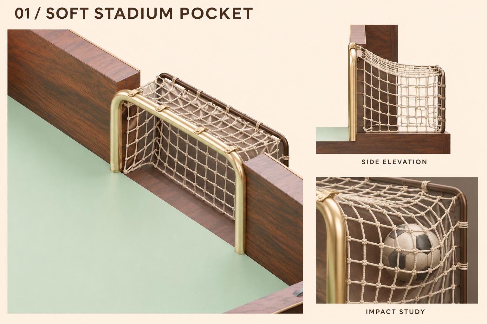
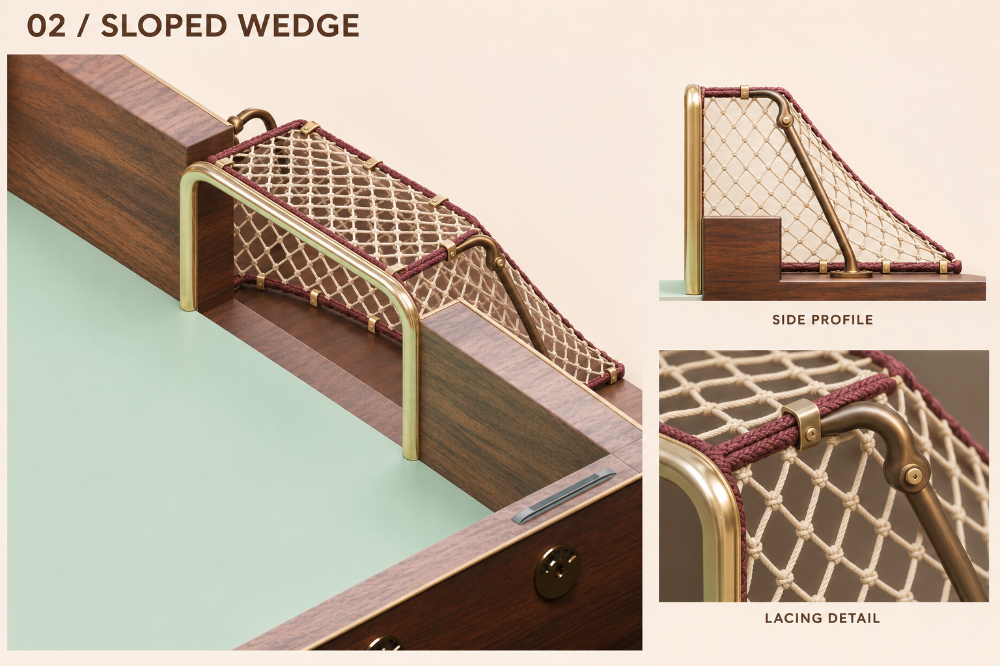
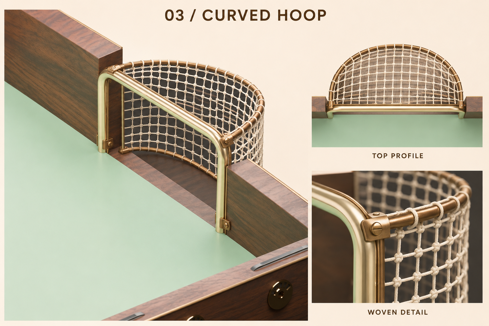
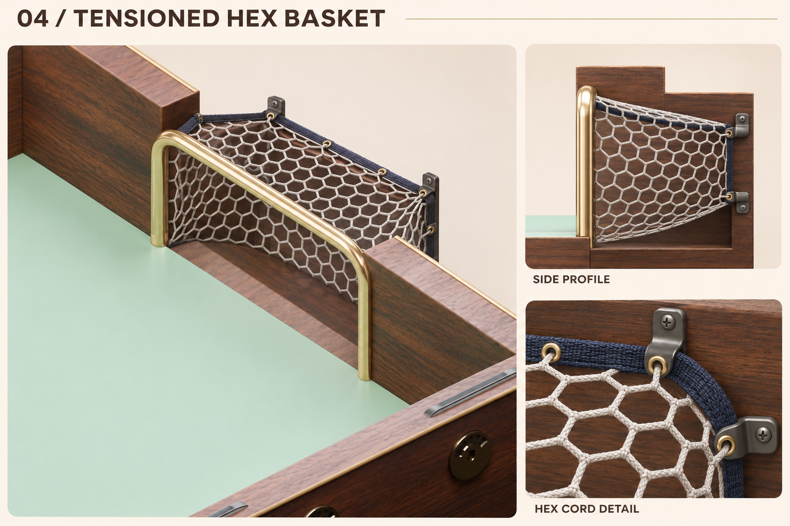

# Goal net concepts — 19 November 2026

Generated with the built-in image generation tool using a fresh render of the actual championship table GLB and an assembled in-game table screenshot as geometry references. Concept art, not exported meshes. The game source and assets were not changed.

Geometry anchor: CONFIG.table in js/config.js: goal opening 22 wide × 10.2 high, depth 9 game units, goal line x=±60, field 120×68. Reference model: assets/tables/classic/fuzeball_table_classic_championship.glb. The net renders should be interpreted as visual design studies; final meshes need to fit the existing collision volume, big-goal morph and net impact shader.

## 01 / SOFT STADIUM POCKET



A premium classic soft box-shaped football net. Ivory braided nylon square mesh with visible small knots, tiny brass lacing clips on the back of the existing front frame. A narrow dark bronze rectangular rear support hoop within the 9-unit depth. The upper net has a slight catenary dip between supports; rear net bows gently backward at the centre while staying inside the depth envelope, and lower corners gather naturally without excessive folds. Rounded cloth shoulders, no straight stretched diamond sheet. The whole net feels supple, elegant and authentic. Show in the small detail how a ball would create a local rounded indentation with tension radiating into adjacent mesh, labelled IMPACT STUDY; the big installed hero is the relaxed net without a ball.

## 02 / SLOPED WEDGE



A distinctive compact classic match-day net with a trapezoid side profile: full 10.2 height at the front, short flat roof reaching about 3 units back, then a diagonal rear curtain sloping outward to a lower rear bar at the full 9-unit depth and 1 unit above floor. Warm off-white DIAMOND mesh cord with a narrow muted burgundy braided perimeter cord, delicate bronze elbow side struts mounted outside the net. The slope is visibly textile with slight belly, not a hard flat plane. Net side panels triangulate naturally into the deeper base. Tidy clipped lower hem, gentle sag only, no loose puddle. Show SIDE PROFILE and LACING DETAIL in right views. Keep opening wide and unobstructed.

## 03 / CURVED HOOP



A rounded D-shaped rear pocket in PLAN VIEW: a thin bronze D-shaped horizontal perimeter hoop at roof height and a matching D-shaped hoop at base, attached to the existing rectangular front frame. Looking down, the rear footprint bows outward in a smooth semicircular arc reaching full 9-unit depth at centre, returning to front posts at sides; width still 22. Fine ivory square woven mesh gracefully wraps around the arc with slight textile waviness; roof canopy laced to top hoop, soft rounded shoulders and no hard rear corners. The side elevation is almost vertical and full-height, curved in plan rather than sagging into the ball space. Refined bronze small clamp fittings, comfortable sculpted pocket, suitable for a premium sports table. On right show TOP PROFILE instead of side elevation so the D-shaped footprint is unmistakable, plus WOVEN DETAIL.

## 04 / TENSIONED HEX BASKET



A modern sporting net with a softly faceted tapered basket shape. Keep the brass existing front frame and walnut cabinet; add small satin graphite rear support brackets rather than replacing the front frame. Rear perimeter is 19 units wide by 9.4 tall, at 8 units depth; the flexible basket rounds into this narrower rear outline inside the envelope. Fine SILVERY WHITE textile hexagonal open mesh with a few restrained muted navy perimeter bands. Mesh is braided flexible polymer cord, not metallic chicken wire. Contrasting dark rear edge and small tidy tension eyelets, subtle organic bow between fixings. No neon, no hologram, no solid panels. Slight corner darts make sculpted textile form credible. Show SIDE PROFILE and HEX CORD DETAIL in right views. The modern feel comes from the hex cells and tidy hardware, while the original table remains the same.

## Final prompts

Each image uses this common prompt, followed by its title and design direction above:

```
Use case: stylized-concept.
Asset type: Fuzeball game goal-net replacement concept sheet.
Input image 1 is the exact table geometry reference (rendered from the game's GLB), NOT a style to replace; image 2 is the whole assembled game table for context. Build your concept onto this existing table goal. Preserve the walnut cabinet, thin brass rounded rectangular front goal frame, flat green pitch and end wall cutout. No redesign of the table. The net goes BEHIND the opening, OUTSIDE the pitch, through the cutout, never across the mouth.
Geometry: playing field 120 long x 68 wide. Goal line x=60; opening 22 wide x 10.2 high; net occupies x=60..69, z=-11..11, y=0..10.2 game units. 9 units maximum depth. Keep front opening and collision envelope. Keep net roof close to y=10.2; most silhouette variation should be behind the frame. Fine credible flexible woven cord mesh with transparent open holes, continuous connected strands, subtle gravity curvature and proper attachment clips. Do not depict a translucent solid panel or a rigid metal fence. No mesh across front opening.
Composition: polished LANDSCAPE industrial design concept board on warm off-white background, generous margins. One large three-quarter close-up of the concept installed in the reference table occupying left two-thirds; on right a clean side elevation showing pocket depth and a smaller rear detail of knots and attachments. Table can crop to show just this end. The net must be visually distinct from the background and easily seen. Realistic game asset product render, tactile cord, attractive lighting, practical manufacturable hardware. Three views must describe the same design. Only a short title at top and small view labels, no paragraph annotations, no invented dimensions, no watermark.

```

